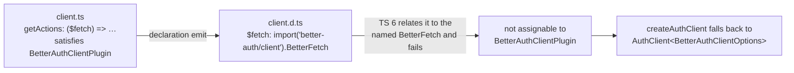

# Repro: `polarClient()` is not a `BetterAuthClientPlugin` on TypeScript 6

`createAuthClient({ plugins: [polarClient()] })` rejects the plugin, and the client drops every
plugin action:

```text
index.ts(5,13): error TS2322: Type '{ id: "polar-client"; ...; getActions: ($fetch: BetterFetch<CreateFetchOption, unknown, unknown, Schema | undefined>) => { ...; }; }' is not assignable to type 'BetterAuthClientPlugin'.
  Types of property 'getActions' are incompatible.
    ...
      Types of parameters '$fetch' and '$fetch' are incompatible.
        Types of parameters 'options' and 'options' are incompatible.
index.ts(8,12): error TS2339: Property 'checkout' does not exist on type 'AuthClient<BetterAuthClientOptions>'.
```



| | |
| --- | --- |
| `better-auth` | 1.7.7 (one `@better-fetch/fetch`, 1.3.2) |
| `@polar-sh/better-auth` | 2.1.0 (latest) |
| `@polar-sh/sdk` | 1.0.2 |
| `typescript` | 6.0.3 |
| `node` | v24.20.0 |

## Run it

```bash
pnpm install
pnpm exec tsc --noEmit
```

[`repro.log`](./repro.log) holds the full output of both runs:

| TypeScript | Result |
| --- | --- |
| 6.0.3 | plugin rejected (TS2322), `authClient.checkout` missing (TS2339) |
| 7.0.2 (control) | plugin accepted; only the deliberate `doesNotExist` typo fails |

Expected: the only error is TS2339 on `authClient.doesNotExist()`, as on TypeScript 7.

`strictFunctionTypes`, `skipLibCheck` and `exactOptionalPropertyTypes` do not change the result.

## Cause

`src/client.ts` leaves `$fetch` to contextual typing from `satisfies BetterAuthClientPlugin`, so
declaration emit writes the parameter as an import type:

```ts
getActions: ($fetch: import("better-auth/client").BetterFetch) => { ... }
```

`BetterAuthClientPlugin` names the same alias through a named import. There is one
`@better-fetch/fetch`, yet TypeScript 6 treats `import("better-auth/client").BetterFetch` and the
named `BetterFetch` as two instantiations of a generic call signature, and relating them fails on
`BetterFetch`'s conditional `options` tuple. A parameter typed with the named import passes:

```ts
import type { BetterFetch } from 'better-auth/client'

getActions: ($fetch: BetterFetch) => { ... }
```
