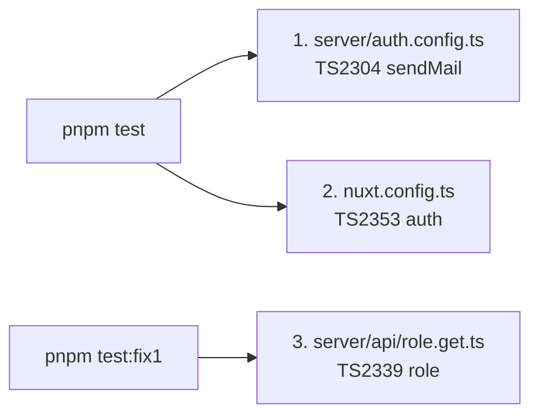

# Repro: `@nuxtjs/better-auth` 0.3.9 type errors on Nuxt 5 (Nitro 3)

Three independent type bugs in one minimal app. Each one fails `nuxt typecheck`.



| | |
| --- | --- |
| `@nuxtjs/better-auth` | 0.3.9 (latest) |
| `better-auth` | 1.7.7 |
| `nuxt` | `nuxt-nightly@5.0.0-2610111729-78f43dd` (nitro 3.0.260903-beta) |
| `typescript` / `vue-tsc` | 6.0.3 / 3.3.13 |
| `node` | v24.20.0 |

## Run it

```bash
pnpm install
pnpm test        # bugs 1 and 2
pnpm test:fix1   # patches bug 1 in node_modules, which exposes bug 3
```

`pnpm test`:

```text
nuxt.config.ts(5,20): error TS2353: Object literal may only specify known properties, and 'auth' does not exist in type '{ cache?: false | { name?: string | undefined; ... } | un...'.
server/auth.config.ts(12,13): error TS2304: Cannot find name 'sendMail'.
```

`pnpm test:fix1` adds:

```text
server/api/role.get.ts(5,23): error TS2339: Property 'role' does not exist on type 'AuthUser'.
```

`test:fix1` edits `node_modules/@nuxtjs/better-auth/dist/module.mjs` in place. Reinstall to undo it.

## 1. Server auto-imports are untyped in `server/auth.config.ts`

[`server/auth.config.ts`](./server/auth.config.ts) calls `sendMail`, auto-imported from
[`server/utils/mail.ts`](./server/utils/mail.ts). The module references
`.nuxt/types/nitro-imports.d.ts`, Nitro 2's file name. Nuxt 5 writes
`.nuxt/types/server-imports.d.ts`, so the node program has no server auto-imports.

## 2. `auth` route rule rejected in `nuxt.config.ts`

[`modules/robots-rule.ts`](./modules/robots-rule.ts) types a `robots` route rule the way
Nitro 3 documents it: on the `RouteRuleConfig` that `nitro/types` re-exports. With that
declaration loaded first, the module's `auth` declaration, made on h3's resolved
`h3/dist/rules/index.mjs` path, no longer reaches the type `routeRules` is checked against.
Delete the local module and `auth` type-checks again.

## 3. Inferred user fields missing in server routes, shared program only

[`server/api/role.get.ts`](./server/api/role.get.ts) reads `user.role`, which the admin
plugin adds. Nuxt 5's `.nuxt/server-routes.d.ts` imports every server route, and the shared
program reaches it through the server auto-imports. The module adds its inferred user and
session types to the shared program only when it judges the server config shared-safe.
The `#server/app.ts` import in `server/auth.config.ts` makes it unsafe, so the shared program
types `user` as the bare `AuthUser`. The server program still passes.

It only shows once bug 1 is fixed: until then the shared program cannot see the server
auto-imports at all.
