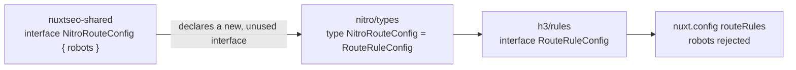

# Repro: nuxtseo-shared route rule keys are untyped on Nitro 3 (Nuxt 5)

On Nuxt 5, `nuxt typecheck` rejects `@nuxtjs/robots`' `robots` key in `routeRules`:

```text
nuxt.config.ts(6,19): error TS2353: Object literal may only specify known properties, and 'robots' does not exist in type '{ cache?: false | { name?: string | undefined; ... } | un...'.
```



| | |
| --- | --- |
| `nuxt` | `nuxt-nightly@5.0.0-2610111729-78f43dd` (nitro 3.0.260903-beta) |
| `@nuxtjs/robots` | 7.0.2 (brings `nuxtseo-shared` 6.0.2) |
| `typescript` / `vue-tsc` | 6.0.3 / 3.3.13 |
| `node` | v24.20.0 |

## Run it

```bash
pnpm install
pnpm exec nuxt typecheck
```

[`repro.log`](./repro.log) holds both runs:

| Nuxt | Result |
| --- | --- |
| nightly 5.0.0-2610111729-78f43dd | `robots` rejected (TS2353) |
| 4.6.1 (control, same config) | passes |

Expected: `routeRules: { '/private': { robots: false } }` type-checks on Nuxt 5, as it does on Nuxt 4.

## Cause

`renderNitroTypeAugmentations` in `nuxtseo-shared` writes the module's route rule keys into
`.nuxt/types/nuxt-robots-nitro.d.ts` as:

```ts
declare module 'nitro/types' {
  interface NitroRouteRules { robots?: ... }
  interface NitroRouteConfig { robots?: ... }
}
```

Nitro 3 keeps those two names only as deprecated type aliases:

```ts
// nitro/dist/types/index.d.mts
export type NitroRouteConfig = RouteRuleConfig$1;
export type NitroRouteRules = NormalizedRouteRules$1;
```

An `interface` declaration cannot merge into a type alias, so the keys land on nothing.
Nitro 3's migration guide points to `RouteRuleConfig` and `RouteRules`, re-exported from
`nitro/types`; h3 documents those two interfaces for augmentation. The same applies to
the sitemap and OG image keys, and to `site` from `nuxt-site-config`.
